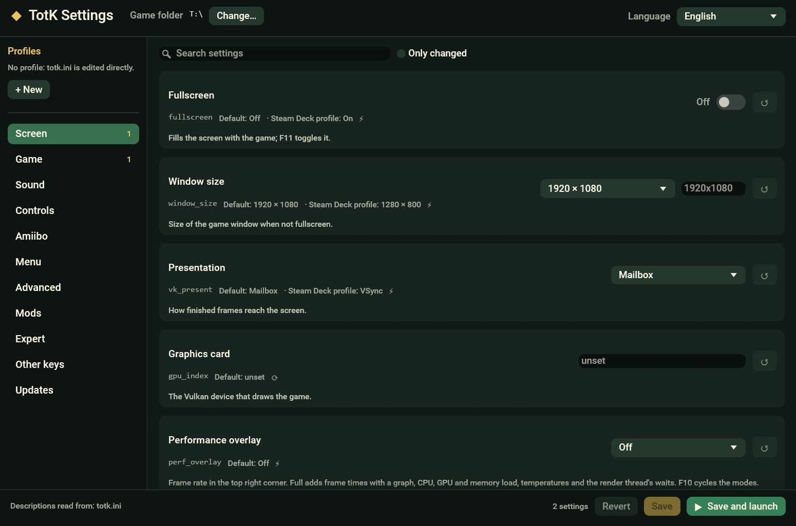

# totk-config

`totk-config.exe` is a settings window for the [TotK PC recomp](https://github.com/valentderah/totk-pc-recomp): it
edits `totk.ini` and named settings profiles before the game starts. It is not part of the recomp itself; it is built
from the recomp's own sources so that it always lists exactly the settings the runtime knows.

**Version = recomp version.** totk-config `0.4.1` is made from the recomp's `main` at version `0.4.1` (its `VERSION`
file). A GitHub Actions job checks the recomp's `main` every three hours and, when `VERSION` names a version that has
no release here yet, regenerates the settings list from that commit, runs the tests, builds the exe and publishes the
release `v<version>`.

Download: [Releases](https://github.com/itaskaev2/totk-config/releases/latest).

- Windows x86-64: `totk-config.exe`, no installer, nothing else needed.
- Linux x86-64: `totk-config-linux-x86_64.tar.gz` (the binary `totk-config` with the licence files). See "Linux" below.



## Use

Put `totk-config.exe` next to `totk.exe` and run it. It finds `totk.ini` there (the runtime reads `totk.ini` from the
folder of `totk.exe` and nowhere else). Started elsewhere it opens the folder it used last or the recomp installer's
install folder, and **Change...** picks another. Use the release whose version matches your recomp install; an older
or newer one works too, see "New settings without a new configurator" below.

- Every setting the runtime knows, on the tabs of the in-game menu (F1) with the menu's names and descriptions in its
  language (English, Russian, Brazilian Portuguese, Simplified Chinese), plus **Expert** for the keys of the recomp's
  `docs/settings.md` and **Other keys** for keys of `totk.ini` the game does not know. Search looks through names,
  keys and descriptions.
- A gold mark shows a setting `totk.ini` sets; the reset button removes its line, back to the default. A setting a
  `TOTK_*` environment variable sets is marked: the variable wins over the file.
- **Save** writes only the lines of the settings that changed, the way the in-game menu does: comments, unknown keys
  and the order of the file stay.
- **Profiles** are named sets of settings in `profiles\<name>.ini` next to `totk.ini`, in the same format. The active
  profile is what `totk.ini` holds: choosing another stores `totk.ini`'s settings into the profile that was active
  and copies the chosen one into `totk.ini`. A new profile starts from the current settings, the defaults, or the
  current settings with the Quality, Performance, Potato mode or Steam Deck changes; the window lists each change and
  why it is there. Potato mode is for GPUs with about 2 GB of video memory.
- **Save and launch** saves and starts `totk.exe`.
- **Updates** (of the game, not of this tool): the tab shows the recomp version in the folder and the latest
  [recomp release](https://github.com/valentderah/totk-pc-recomp/releases). **Download and install** asks first,
  downloads `TotK-Setup-<version>-windows.zip`, checks its size and SHA-256 against what GitHub lists, unpacks it and
  starts that release's setup on the folder. It asks GitHub only on **Check now**, or at every start when you tick
  that option (kept in `%LOCALAPPDATA%\TotK Recomp\configurator.json`, not in `totk.ini`).
- **New settings without a new configurator.** At start it reads `totk.ini.example` and `docs/settings.md` when they
  are next to the game (or in a parent folder, so a source checkout works) and the comments of `totk.ini`. A key they
  describe that the built-in list lacks gets a row of its own, and a `totk-settings.json` there (what
  `tools/gen_configurator_settings.py` writes) replaces the built-in list whole. The bottom of the left column lists
  the files it read.

### Linux

The recomp also builds and runs on x86-64 Linux, where the game is `totk` instead of `totk.exe`. Unpack the archive and
put `totk-config` next to `totk`:

```
tar -xzf totk-config-linux-x86_64.tar.gz
cp totk-config/totk-config /path/to/game/ && /path/to/game/totk-config
```

It opens an X11 or Wayland window (OpenGL through EGL or GLX; libX11, libwayland-client, libxkbcommon and libGL/libEGL
are loaded at run time, as any desktop has them), needs glibc 2.35 or newer (Ubuntu 22.04, Debian 12, SteamOS 3 and
later) and uses the XDG desktop portal for the folder picker. The Updates tab is Windows-only: the recomp's releases are
Windows installers, so on Linux update the game the way you built it. Its own settings go to
`$XDG_STATE_HOME/TotK Recomp` (`~/.local/state/TotK Recomp`).

Without a window: `totk-config --set fps_limit=120 --set fov=` (an empty value resets), `totk-config --check-update`,
`totk-config --new-profile Travel --from deck`, `totk-config --profile Travel`; `--dir <folder>` names the game folder.

## Build

Rust (stable), Python 3 (standard library) and a checkout of the recomp in `upstream/` (gitignored), or anywhere with
`TOTK_RECOMP_DIR` (or `--upstream`) pointing at it:

```
git clone --depth 1 https://github.com/valentderah/totk-pc-recomp upstream
python tools/gen_configurator_settings.py      # settings.json and the version in Cargo.toml / Cargo.lock
cargo test --locked                            # totk.ini reading and writing, profiles, settings.json against cfg.c
cargo build --release --locked                 # target\release\totk-config.exe
```

`cargo build` alone needs no checkout: `settings.json` is committed. With the GNU Rust toolchain (no MSVC), crates
that use the `windows` bindings need `dlltool` from MinGW-w64 (WinLibs or MSYS2 UCRT64) on PATH, and `build.rs` runs
its `windres` to embed the icon. CI uses the MSVC toolchain on `windows-latest`. On Linux a C compiler is enough
(`ring` builds C and assembly); no `-dev` packages are needed, since the window system libraries are loaded at run time
and HTTPS goes through rustls. CI builds the Linux binary on `ubuntu-22.04`.

`settings.json` is never edited by hand. `tools/gen_configurator_settings.py` writes it from the recomp's
`runtime/cfg.c` (`known[]`, `metas[]`, `sections[]`), `runtime/ui/menu.cpp` (tabs, groups, order, slider ranges,
choice names), `runtime/ui_text.c` (menu texts), `runtime/input_map.c` (key, button and action names, default
bindings), `totk.ini.example` and `docs/settings.md`, and copies the recomp's `VERSION` into the package version;
`--check` fails when either is out of date. The tests in `src/data.rs` and `src/docs.rs` read the same checkout and
fail when `settings.json` and `runtime/cfg.c` disagree. The icon, `totk-config.ico`, is the recomp's `runtime/totk.ico`
with a wrench drawn over it by `python tools/make_configurator_icon.py` (Pillow).

| File | What it holds |
| --- | --- |
| `settings.json` | Every setting, written by `tools/gen_configurator_settings.py` from the recomp's sources. |
| `src/ini.rs` | `totk.ini` read and written as `runtime/cfg.c` `cfg_load` and `cfg_save_to` do. |
| `src/profiles.rs` | `profiles/<name>.ini` and `profiles/active.txt` next to `totk.ini`. |
| `src/presets.rs` | The starting points of a new profile (Quality, Performance, Potato mode, the runtime's Steam Deck profile). |
| `src/data.rs` | `settings.json` as types; the tests that compare it with `runtime/cfg.c`. |
| `src/docs.rs` | What it reads at start: `totk.ini.example`, `docs/settings.md`, `totk.ini` comments and a newer `totk-settings.json`. |
| `src/update.rs` | Game updates from the recomp's GitHub releases. Tests run it against a fake GitHub on 127.0.0.1. |
| `src/prefs.rs` | The configurator's own settings (`configurator.json`). |
| `src/app.rs`, `src/theme.rs`, `src/i18n.rs` | The window, the in-game menu's colours and font, the window's own words in English and Russian. |
| `.github/workflows/release.yml` | The check of the recomp's `main` and the build and release of a new version. |
| `.github/workflows/ci.yml` | Tests of every push and pull request on Windows and Linux against the recomp commit in `upstream-commit.txt`. |
| `tools/third_party_crates.py` | The crate licence tables of `THIRD_PARTY_NOTICES.md`, per target, from `Cargo.lock`. |

### Releases

`release.yml` runs every three hours and on demand (Actions, "Release", Run workflow). It reads `VERSION` at the
recomp's `main` and stops when the release `v<VERSION>` exists here. Otherwise it checks out the recomp at that
commit, runs the generator, `cargo test` and the release build, commits the new `settings.json` and version to `main`
here, tags it `v<VERSION>` and publishes the release with `totk-config.exe` (built on `windows-latest`),
`totk-config-linux-x86_64.tar.gz` (built on `ubuntu-22.04`), their SHA-256 and the licence files. Run
it by hand with **force** to rebuild the current version (for a change in this repo; the release's files are
replaced), or with **ref** set to a recomp tag or commit. It needs nothing but the default `GITHUB_TOKEN`.

GitHub turns scheduled workflows off in a repository with no activity for 60 days; every release commit counts as
activity, so this only happens when the recomp itself has no new version for two months. Turn it back on in the
Actions tab.

## Licence

MIT, see [LICENSE](LICENSE), the same licence as the recomp. The font, the icon, the settings texts and the Rust
crates linked into the exe: [THIRD_PARTY_NOTICES.md](THIRD_PARTY_NOTICES.md). The configurator was first written as
[valentderah/totk-pc-recomp#1229](https://github.com/valentderah/totk-pc-recomp/pull/1229); its history is kept here.
